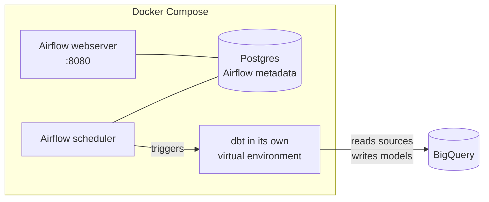

# Local Bike: dbt + Airflow + Docker

A containerized data pipeline that orchestrates a **dbt** project with **Apache Airflow**, running on **BigQuery**. Everything runs locally with a single `docker compose` command.

## What this project does

The dbt project transforms raw bike-shop data (orders, customers, products, stocks, stores...) into analytics-ready tables. Airflow runs the dbt models in the right order every day, retries on failure, and keeps a log of every run.

| Tool | Role |
|---|---|
| **dbt** | Transforms the data with SQL inside BigQuery |
| **Airflow** | Schedules and monitors the dbt runs |
| **Docker** | Packages everything so it runs the same way on any machine |
| **BigQuery** | Data warehouse (raw sources and transformed tables) |

## Architecture



### The DAG

`dags/dbt_pipeline_dag.py` runs four tasks in sequence, once a day:

```
dbt_run_staging  ->  dbt_run_intermediate  ->  dbt_run_mart  ->  dbt_test
```

If a layer fails, the next ones do not run, so the `mart` tables are never built from incomplete data.

### dbt layers

| Layer | Materialization | Content |
|---|---|---|
| `staging` | view | One model per raw source table (9 sources) |
| `intermediate` | view | Business logic joining staging models (`int__sales`, `int__production`) |
| `mart` | table | Final models: `mrt__revenue`, `mrt__stock`, `mrt__promote_local_events` |

The project has 14 models and 29 data tests.

## Project structure

```
local_bike/
├── dags/
│   └── dbt_pipeline_dag.py     # Airflow DAG
├── dbt/                        # dbt project
│   ├── dbt_project.yml
│   ├── profiles.yml            # reads credentials from environment variables
│   └── models/
│       ├── staging/
│       ├── intermediate/
│       └── mart/
├── Dockerfile                  # Airflow image + dbt in a virtual environment
├── docker-compose.yml          # Postgres, Airflow init, webserver, scheduler
├── requirements.txt            # dbt dependencies
├── .env.example                # template for the variables (the real .env is not committed)
└── secrets/                    # GCP key (not committed)
```

## How to run it

### Prerequisites

- Docker Desktop (running)
- A Google Cloud project with BigQuery, and a **service account** with the roles *BigQuery Data Editor* and *BigQuery Job User*
- The raw tables loaded in a BigQuery dataset named `local_bike`

### Steps

1. **Clone the repository**
   ```bash
   git clone https://github.com/<your-username>/<your-repo>.git
   cd <your-repo>
   ```

2. **Add the service account key** as `secrets/gcp-key.json` (create the `secrets` folder if needed). This file is git-ignored.

3. **Create your `.env`** from the template and fill in your values:
   ```bash
   cp .env.example .env
   ```
   ```
   GCP_PROJECT=your-gcp-project-id
   BQ_DATASET=dbt_local_bike
   BQ_LOCATION=US
   ```
   `BQ_LOCATION` must match the location of your source dataset.

4. **Build the image**
   ```bash
   docker build -t local_bike_airflow .
   ```

5. **Check the dbt connection** (optional but recommended)
   ```bash
   docker run --rm --env-file .env \
     -e GOOGLE_APPLICATION_CREDENTIALS=/opt/airflow/secrets/gcp-key.json \
     -v "$(pwd)/dbt:/opt/airflow/dbt" \
     -v "$(pwd)/secrets:/opt/airflow/secrets:ro" \
     --entrypoint /home/airflow/dbt_venv/bin/dbt \
     local_bike_airflow debug --project-dir /opt/airflow/dbt --profiles-dir /opt/airflow/dbt
   ```
   Expected result: `All checks passed!`

6. **Initialize and start Airflow**
   ```bash
   docker compose up airflow-init
   docker compose up -d
   ```

7. **Open the UI** at http://localhost:8080 (user `admin`, password `admin`), then trigger the `dbt_pipeline` DAG.

> The `admin` / `admin` login is for local development only.

On Windows PowerShell, replace `$(pwd)` with `${PWD}` and the `\` line endings with backticks.

## Design choices and lessons learned

- **dbt runs in its own Python virtual environment** inside the image. Airflow and dbt both have many dependencies, and installing them together often causes version conflicts. Isolating dbt avoids that.
- **No secrets in the repository.** `profiles.yml` reads everything through `env_var()`, the real values live in `.env`, and the GCP key is mounted at runtime as a read-only volume. Both are in `.gitignore`.
- **Volumes for `dags/` and `dbt/`.** Editing a DAG or a dbt model on the host is picked up by Airflow without rebuilding the image.
- **dbt version must match the project.** The dbt project uses the `arguments:` syntax for generic tests, which dbt 1.9 rejects. Pinning dbt 1.10 in `requirements.txt` fixed it. Recreating the containers (`docker compose up -d --force-recreate`) is needed after rebuilding the image.
- **Port conflicts.** Only one container can publish port 8080 on the host. If another service already uses it, change the left side of `"8080:8080"` in `docker-compose.yml`.
